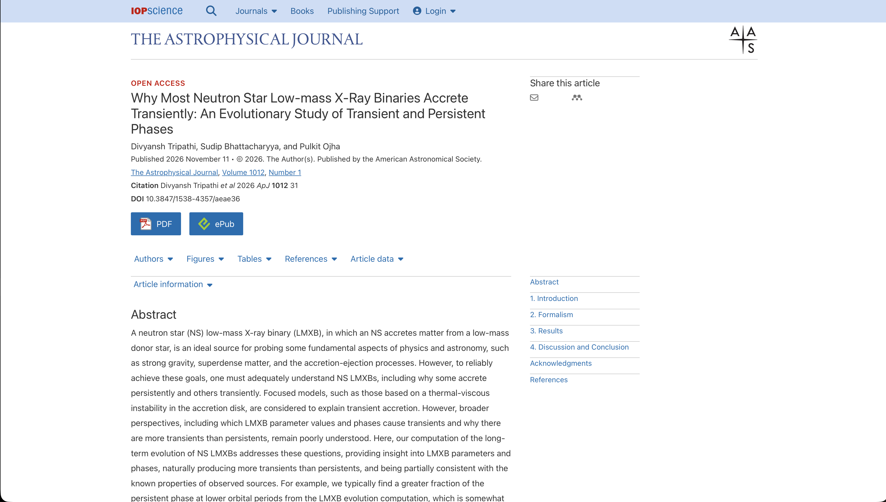
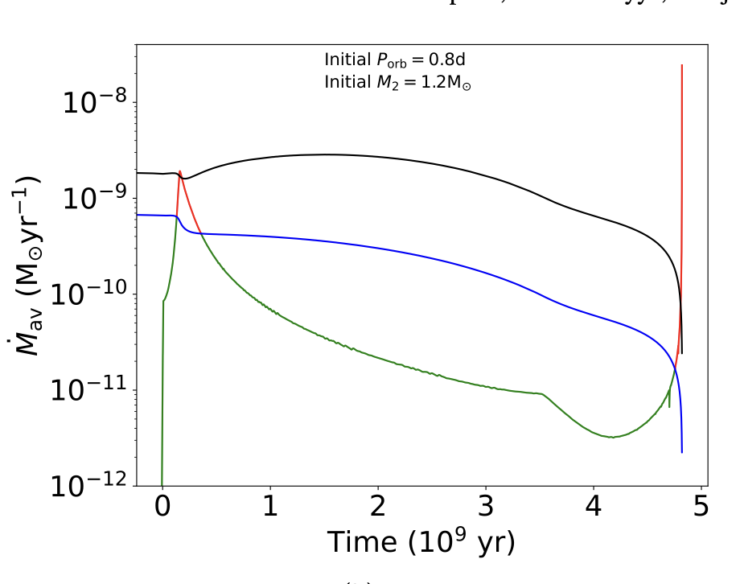
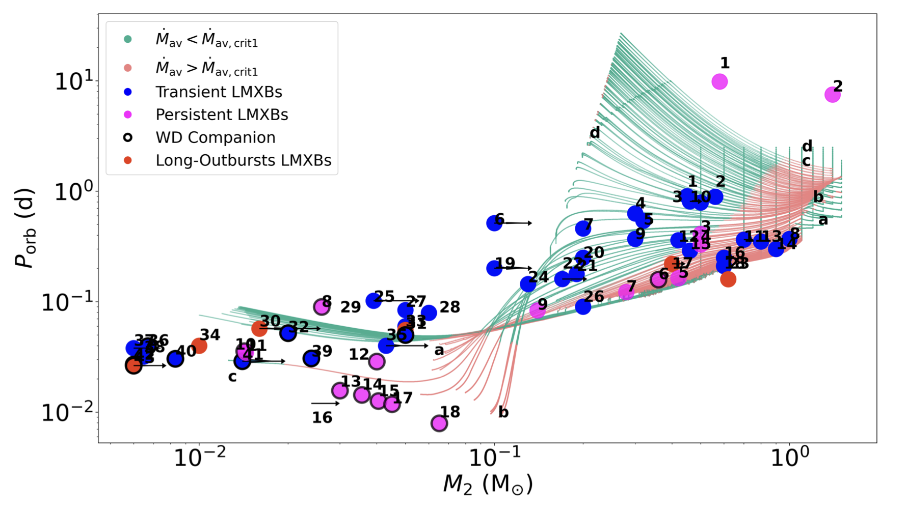

- **Title:** Why most neutron star low-mass X-ray binaries accrete transiently: an evolutionary study of transient and persistent phases
- **Authors** Divyansh Tripathi, Sudip Bhattacharyya, Pulkit Ojha
- **Status** Accepted For publication in Astrophysical Journal ([Open](https://iopscience.iop.org/article/10.3847/1538-4357/aeae36) Access)



  

# Introduction

Neutron stars are one of the most exciting objects in the universe. They mark the end state of stellar evolution of massive stars along with their much heavier cousins, black holes.
If we put these neutron stars along with another main-sequence companion, generally less massive than the neutron stars in a binary system, we get a neutron star low mass X-ray binary systems (NS-LMXBs).

As the companion star evolves, it expands and at some point (Jargon Alert ⚠️ known as **Roche Lobe**) start transferring mass to the neutron star. The process is called accretion and since starts are rotating we have angular momentum which make the accreting matter to form a disk around the neutron star. As the matter falls onto the neutron star, it releases a lot of energy in the form of X-rays. Hence, the term X-ray in LMXBs.

During observation, we find two types of these systems, one which are emitting X-rays at nearly constant rate for a long period of time (**Persistent**), the other which shows episodes high x-ray emission followed by long period of low or no emission (**Transient**). 

<video>
  <source src="video_showing_matter_accretion.mp4" type="video/mp4">
  <caption>Video showing matter accretion from companion star to neutron star in a binary system. Credit: [Google Gemini](https://gemini.google.com/)</caption>
</video>

# Problem Statement

The above description of Transient and persistent populations arises a natural question. **What factors influence the birth of these two populations?**. In other words, why do some systems accrete persistently while others accrete transiently?
Along with this we broadly want to understand,

- Why are transient neutron star LMXBs more numerous than persistent ones?
- Does a binary system remain transient or persistent throughout its lifetime?
- Can a system change from transient to persistent and back again?
- How do the initial orbital period and companion-star mass influence its eventual behaviour?

# Current Understanding

On why do accretion disks in LMXBs show this episodic behaviour, there is a well known model called (Jargon Alert ⚠️) **Disk Instability Model (DIM)**. According to this model, the accretion disk can be in two states, one which is hot and ionized and the other which is cold and neutral. The transition between these two states is governed by the mass transfer rate from the companion star. If the mass transfer rate is high enough, the disk remains in hot state and accretes persistently. If the mass transfer rate is low, the disk becomes unstable and shows episodic behaviour. But the boundary between what should be called high-enough accretion rate is not clear and hence there are many benchmarks for the accretion rate given by previous works above which accretion can be classified as persistent and below which it can be classified as transient. The benchmark rate is called as critical rate and is denoted by $\dot{M}_{\rm crit}$. The critical rate depends on the depends on the physical parameter of the binary system like orbital period ($P_{\rm orb}$), Neutron star mass ($M_1$) and companion mass ($M_2$).

So in short,

$$
\begin{align}
  \dot{M} \geq \dot{M}_{\rm crit} & \implies \text{Persistent System} \\
  \dot{M} \lt \dot{M}_{\rm crit} & \implies \text{Transient System}
\end{align}
$$

# Methodology

Armed with the great work of our predecessors, and the power of great simulation codes, we are ready to throw some light on the problem. We started to simulate the LMXB system using stellar evolution code named [**MESA**](https://mesastar.org). (*Do check their website, it is a great resource for stellar evolution simulation*). To cover most of the physical parameters space of companion stars, we varied the initial parameters of the LMXB systems. We varied the initial companion mass and orbital period of the system. For each of these systems we calculated the mass transfer rate and saw how it varies as companion star goes through different stages of its evolution. This helped us track the at which stage of life cycles these systems are likely to be persistent or transient.

We also compared the calculated mass transfer rate with the different mass critical rates reported in literature to see if the system is likely to be persistent or transient.

*One of the figure from the paper showing how mass transfer rate varies in case of system with initial mass 1.2 $M_\odot$ and orbital period 0.8 days. The continuous curve represents the accretion rate while the black and blue curves represents the critical rate*

Next we compared our accretion rate curves with the observed population of LMXBs. We have taken a sample 43 transient and 18 persistent observed system. We plot both the observed and simulated systems in the donor mass-orbital period space 

*Comparison of observed(denoted by circles) and simulated LMXBs evolutionay path (denoted by curves) in the donor mass-orbital period space. Blue circles denote persistent systems and red and pink circles denotes transient systems*

# What did we find?

Now the most important question, *what did we find?* ~~Because to be honest without it all these simulations and calculations are just a huge exercise in running simulations~~.

1. A binary can change from transient to persistent and back again during its lifetime. So depending on which stage of evolution we observe a system, it can be classified as transient or persistent.

2. We found that most systems across the parameter space spent most of their lifetime in transient phase, which is consistent with the observed population of LMXBs.

3. Systems with short orbital periods have long persistent phases. This is also consistent with the observed population of LMXBs as most of Ultra Compact Binaries (UCXBs) with extremely short orbital periods are observed to be in the persistent phases.

4. We established that DIM model is good enough model but to explain the observation better we need to better models

With these findings I conclude our study. I hope you enjoyed reading this post and if you have any questions or suggestions to make this and futute post better, please feel free to reach out to me on [divyanshtripathi151@gmail.com](mailto:divyanshtripathi151@gmail.com)
---

 THE END

